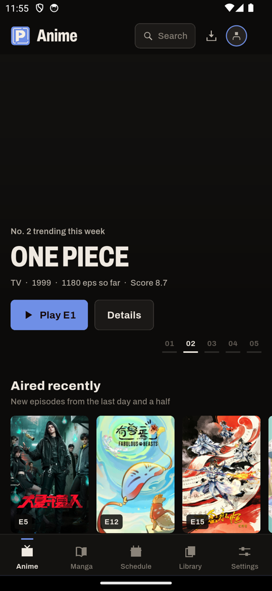
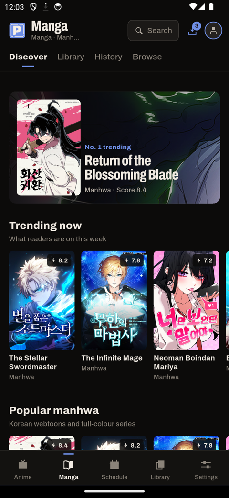
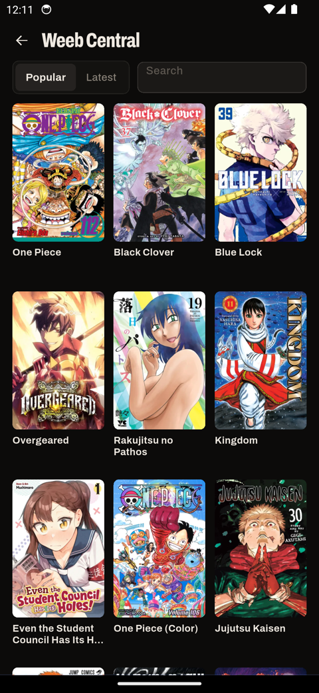
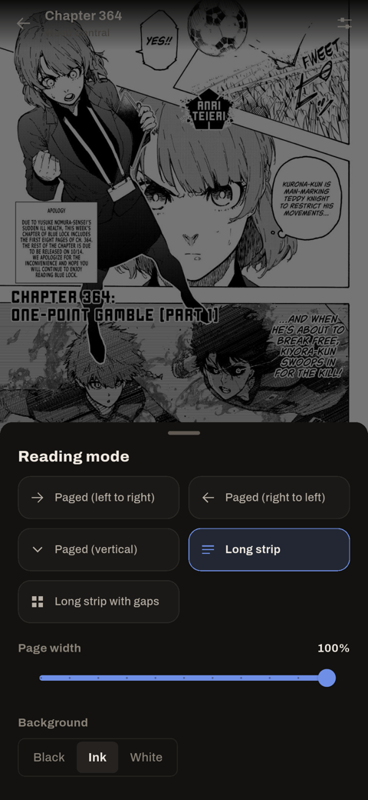
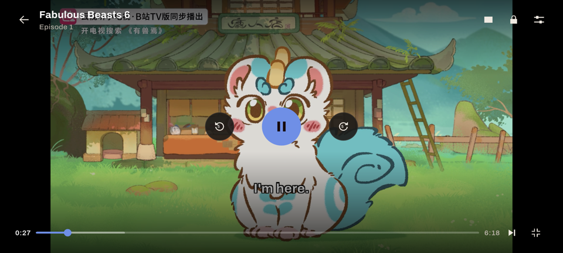

<p align="center">
<a href="https://playzae.github.io/playz_anime_landingpage/">

</a>
</p>

<h1 align="center"><b>PlayzAnime</b></h1>

<p align="center"><b>Watch anime and read manga, manhwa and manhua. Free, no ads, open source.</b><br/>Windows desktop app and Android app, in one repo.</p>

<p align="center">

</p>

<p align="center">
  <a href="https://playzae.github.io/playz_anime_landingpage/">Website</a> |
  <a href="https://github.com/PlayzAe/playz_anime_app/releases/latest">Download</a> |
  <a href="https://playzae.github.io/playz_anime_landingpage/docs">Documentation</a> |
  <a href="https://playz-anime.onrender.com">Web app</a> |
  <a href="https://playzae.github.io/playz_anime_landingpage/docs/policies/copyright-and-dmca">Copyright</a>
</p>

<div align="center">
  <a href="https://github.com/PlayzAe/playz_anime_app/stargazers"></a>
  <a href="https://github.com/PlayzAe/playz_anime_app/releases/latest"></a>
  
  <a href="LEGAL.md"></a>
</div>

<h5 align="center">Leave a star if you like the project.</h5>

> [!IMPORTANT]
> PlayzAnime does not host, upload or store any video or image files. Episodes and chapters come from third-party sites and public APIs. You are responsible for following the laws where you live. See [LEGAL.md](LEGAL.md).

---

## Contents

- [Download](#download)
- [Screenshots](#screenshots)
- [What it does](#what-it-does)
- [Repository layout](#repository-layout)
- [Desktop app: build, run and test](#desktop-app-build-run-and-test)
- [Android app: build, run and test](#android-app-build-run-and-test)
- [Help wanted: Linux, macOS and iOS](#help-wanted-linux-macos-and-ios)

## Download

Every build is on the [releases page](https://github.com/PlayzAe/playz_anime_app/releases/latest).

| Platform | File | Notes |
| --- | --- | --- |
| Windows 10 / 11 | `PlayzAnime-Setup-<version>.exe` | Installer with Start menu and desktop shortcuts |
| Windows 10 / 11 | `PlayzAnime-Portable-<version>.exe` | One file, runs without installing |
| Android 7+ | `PlayzAnime-<version>-universal.apk` | One APK for every phone and tablet |

**Windows:** SmartScreen may warn that the app is unrecognised. Click **More info → Run anyway**.
**Android:** allow your browser to install unknown apps when asked. If Play Protect warns, tap **More details → Install anyway**. See [Install on Android](https://playzae.github.io/playz_anime_landingpage/docs/android/install-on-android).

## Screenshots

**Windows**

<p align="center"></p>

<table>
  <tr>
    <td width="50%"><br/><sub>Manga, manhwa and manhua from many sources</sub></td>
    <td width="50%"><br/><sub>Downloads grouped by series</sub></td>
  </tr>
</table>

**Android**

<table>
  <tr>
    <td></td>
    <td></td>
    <td></td>
    <td></td>
  </tr>
</table>
<p align="center"></p>

## What it does

**Both apps**

- **Anime:** AniList catalogue, airing schedule, sub and dub, a player with no ads, skip intro and up next, subtitle styling.
- **Manga, manhwa and manhua:** several built-in sources read at once; the app picks whichever is furthest along.
- **Downloads:** pick episodes, quality, audio and subtitles; chapters save as CBZ. Downloads resume after a restart and play offline.
- **Profiles:** no accounts. Your list, history and settings stay on your device; back them up or share them as a `.playzanime` file.
- **Five accent colours**, named after traditional Japanese colours. The logo and app icon follow your pick.

**Android extras**

- Real **Mihon extensions** from the keiyoushi repo (1,400+ sites), with one-tap install, daily auto-updates and NSFW filtering.
- A player made for touch: opens in fullscreen, double-tap to skip 5 s, swipe for brightness and volume, picture-in-picture.
- Five reading modes: paged left to right, right to left, vertical, long strip, and long strip with gaps.
- Download progress and now-playing controls in the notification shade.

## Repository layout

```
playz_anime_app/
├─ src/            Windows desktop app (Electron + React + TypeScript)
├─ scripts/        Desktop build, dev server, self-test and screenshot scripts
├─ tools/          Windows helpers (Controlled Folder Access)
├─ docs/           Screenshots and notes
├─ mobile/         Android app (Flutter + Kotlin), see mobile/README.md
├─ build.bat       One-click Windows release build
└─ start.bat       One-click desktop dev run
```

## Desktop app: build, run and test

You need [Node.js](https://nodejs.org/) 20 or newer and Windows 10/11.

```bash
npm install
npm run dev          # desktop app with hot reload (or double-click start.bat)
npm run typecheck    # TypeScript checks for the main and renderer processes
npm run selftest     # offline self-test of the core logic
npm run dist         # installer and portable exe in release/ (or double-click build.bat)
```

`npm start` builds once and opens the app without hot reload.

## Android app: build, run and test

The Android app lives in [`mobile/`](mobile/). Everything about using it is in [mobile/README.md](mobile/README.md). In short:

```bash
cd mobile
flutter pub get
flutter test                      # unit and widget tests
flutter run                       # on a connected phone or emulator
flutter build apk --release       # universal APK in build/app/outputs/flutter-apk/
```

You need Flutter 3.35+ (Dart 3.9+), the Android SDK and JDK 17 or 21. Release builds are signed with a key that isn't in this repo; without it, Gradle signs with the debug key so local builds still work.

## Help wanted: Linux, macOS and iOS

PlayzAnime is a passion project I build in my spare time. Right now it runs on **Windows** and **Android**.

I'm looking for people who'd like to help bring it to:

- **Linux** and **macOS**: the desktop app is Electron, so most of the work is packaging, testing and fixing platform paths and folder access.
- **iOS / iPadOS**: the mobile app is Flutter, so much of `mobile/lib` carries over. The Mihon extension host (`mobile/android/.../ExtHost.kt`) is Android-only and would need another approach.

If you can help, please **fork the repo and open a pull request**, or open an issue to talk about it first. Bug reports, testing on your own device and small fixes are all welcome too. Thank you!

---

<p align="center"><sub>Made with care by <a href="https://github.com/PlayzAe">PlayzAe</a>.</sub></p>
