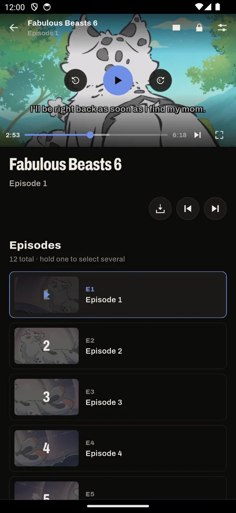
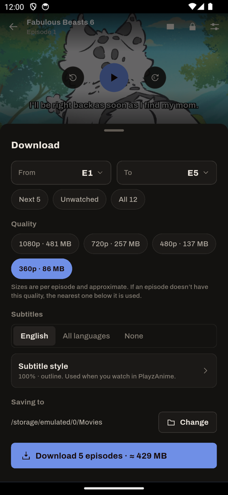

# PlayzAnime for Android

The PlayzAnime app for phones and tablets: anime, manga, manhwa and manhua, rebuilt for touch from the [Windows app](../README.md). Android 7 and newer.

> [!NOTE]
> Right now this is my most up-to-date version of PlayzAnime. It handles extensions well to a point, but it still has issues. **I'm looking for people to help me**: see [Contributing](#contributing).

<p>




</p>

## Install

1. Download `PlayzAnime-<version>-universal.apk` from the [latest release](https://github.com/PlayzAe/playz_anime_app/releases/latest) on your phone.
2. Open it. If Android asks, allow your browser to **install unknown apps**.
3. If Play Protect warns, tap **More details → Install anyway**. The app isn't on the Play Store, which is why it's flagged.

To update, install the new APK over the old one. Your list, downloads and extensions stay.

## Using the app

**First launch.** Pick a name and an accent colour (the home-screen icon changes to match). Allow *Files* and *Notifications* if you want them, then choose the folders for anime and manga downloads.

**Tabs.** Anime · Manga · Schedule · Library · Settings. The top bar has search, your downloads (with a live count) and your profile.

**Watching.** Tap an episode: the phone turns to fullscreen.

- Double-tap the sides to skip 5 s; double-tap the middle to pause.
- Swipe up/down on the left for brightness, on the right for volume.
- Swipe sideways to scrub; hold for 2× speed.
- The settings button changes quality, subtitles, subtitle style, audio, speed, picture fit and player.
- The picture-in-picture button, or leaving the app mid-episode, keeps the video in a small window.
- If an episode won't start, try **Source player**. A bar at the top switches back.

**Reading.** In the reader, the settings button picks a reading mode:

- Paged left to right, paged right to left, or vertical pages.
- Long strip, or long strip with gaps. Strips have an adjustable page width.

**Extensions (optional).** Manga works without them. For extra sites I took inspiration from how [Mihon](https://mihon.app) handles extensions, so the app can load the ones from the [keiyoushi repo](https://github.com/keiyoushi/extensions). It's still buggy: some sources fail to load or need a retry. The first time you open Manga, I offer a few popular ones. Manage them in **Settings → Manga → Extensions**: install, remove, update all, or add another repo. Extensions rated NSFW hide while **Hide adult content** is on.

**Downloads.**

- Tap the download icon on an episode, or hold one to select several.
- Choose the range, quality (with sizes), audio and subtitles.
- Progress shows in your notifications. Pause or resume from **Downloads**.
- Unfinished downloads continue after a restart. With no internet, the app opens on your downloads.

**Backup.** Profile (top right) → **Export profile** saves your list, history and settings as one `.playzanime` file. **Import profile** restores it on any phone. Settings are also kept in `playzanime-settings.ini` in your downloads folder, so a reinstall picks them up.

More in the [Android docs](https://playzae.github.io/playz_anime_landingpage/docs/android/install-on-android).

## Build from source

You need Flutter 3.35 or newer (Dart 3.9+), the Android SDK (platform 36) and JDK 17 or 21.

```bash
cd mobile
flutter pub get
flutter analyze
flutter test                     # unit and widget tests in test/
flutter run                      # debug build on a phone or emulator
flutter build apk --release      # universal APK in build/app/outputs/flutter-apk/
```

### Signing

Release builds read `android/key.properties`:

```properties
storeFile=playzanime-release.jks
storePassword=…
keyAlias=…
keyPassword=…
```

Neither the keystore nor `key.properties` is in the repo. Without them, release builds are signed with the debug key, which installs fine but can't update an official build.

### Network smoke tests

`tool/live/*.dart` hit the real sources (AniList, the streaming host and manga sites). They're kept out of `flutter test` because they need the internet:

```bash
flutter test tool/live/sources_live_test.dart
```

## How it's put together

- `lib/ui/`, `lib/views/`: the screens, built on a small kit (`lib/ui/kit.dart`) that carries the desktop look: ink blacks, condensed Archivo type, the seal accent.
- `lib/services/stream_resolver.dart`: resolves an episode's HLS stream in a headless WebView, the same way the desktop app does.
- `lib/services/downloader.dart`: HLS and chapter downloads with resume, retries and stream-token refresh.
- `lib/sources/manga/`: built-in manga sources and the Dart side of the extension system.
- `android/app/src/main/kotlin/`:
  - `ExtHost.kt` loads keiyoushi extension APKs privately. Flutter and Dart can't run them, so this Kotlin layer does, using a port of Mihon's source API (Apache-2.0) under `eu/kanade/tachiyomi/`. Most of the remaining bugs live here.
  - `MainActivity.kt` and `Notify.kt` handle the launcher icon, picture-in-picture, brightness and volume, permissions and notifications.

## Contributing

This is just a passion project of mine, and **I'm looking for people to help me** with it.

- **Bugs:** please [open an issue](https://github.com/PlayzAe/playz_anime_app/issues), or a pull request if you know the fix. Extensions are the buggiest part.
- **iOS:** a port would be especially welcome. Most of `lib/` is plain Flutter; the extension host is Android-only and would need another approach.

Please run `flutter analyze` and `flutter test` before opening a PR.
